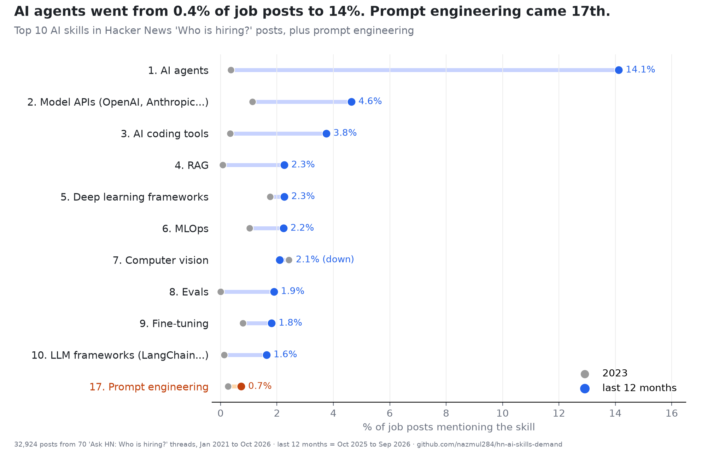
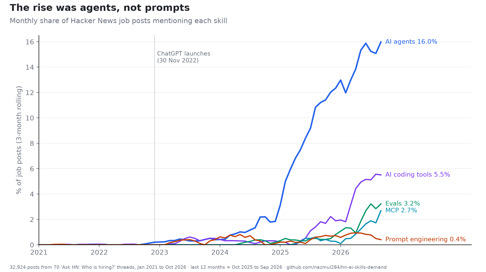

# hn-ai-skills-demand

Which AI skills do employers actually ask for? Every top-level post in 70 Hacker News
"Ask HN: Who is hiring?" threads (January 2021 to October 2026, 32,924 posts), matched
against 21 AI skills. Companion data for the article *The 10 AI Skills Employers Actually
Asked For in 32,924 Hacker News Job Posts, and Prompt Engineering Came 17th*.




## Results

```
% of job posts mentioning each skill
posts counted: 2021 10,285 | 2023 4,171 | last 12m 3,811

  # skill                        2021   2023  last 12m  checked
--- -------------------------   -----  -----  --------  -------
  1 AI agents                    0.01   0.36      14.1      8/8
  2 Model APIs (OpenAI etc.)     0.14   1.13      4.64     6/10
  3 AI coding tools              0.03   0.34      3.75      8/8
  4 RAG                          0.00   0.07      2.26      8/8
  5 Deep learning frameworks     1.56   1.75      2.26      8/8
  6 MLOps                        0.88   1.03      2.23      8/8
  7 Computer vision              1.64   2.42      2.10      6/8
  8 Evals                        0.00   0.00      1.89      8/8
  9 Fine-tuning                  0.01   0.79      1.81      7/8
 10 LLM frameworks               0.00   0.12      1.63      8/8


The rest, same columns

  # skill                        2021   2023  last 12m  checked
--- -------------------------   -----  -----  --------  -------
 11 Embeddings/vector search     0.15   0.89      1.34      8/8
 12 MCP                          0.00   0.00      1.15      8/8
 13 AI safety & guardrails       0.02   0.02      1.13      6/8
 14 Inference & serving          0.04   0.14      0.94      8/8
 15 NLP                          1.44   1.46      0.84      7/8
 16 Speech & voice AI            0.15   0.50      0.81      8/8
 17 Prompt engineering           0.01   0.26      0.73      7/8
 18 Tool calling                 0.13   0.05      0.71      8/8
 19 Classic ML (sklearn etc.)    0.46   0.55      0.42      8/8
 20 Recommender systems          0.23   0.26      0.29      8/8
 21 Context engineering          0.00   0.00      0.21      8/8


Rank by post vs by distinct company, last 12 months

skill                       posts %  rank  companies %  rank
-------------------------   -------  ----  -----------  ----
AI agents                      14.1     1         16.1     1
Model APIs (OpenAI etc.)       4.64     2         5.75     2
AI coding tools                3.75     3         5.20     3
RAG                            2.26     4         2.71     4
Deep learning frameworks       2.26     5         2.39     8
MLOps                          2.23     6         2.48     7
Computer vision                2.10     7         2.02    10
Evals                          1.89     8         2.62     5
Fine-tuning                    1.81     9         2.57     6
LLM frameworks                 1.63    10         2.30     9
Prompt engineering             0.73    17         0.92    18


Languages named in posts, last 12 months, %

language       all posts    any AI   AI agents
                   3,811     1,311         538
-----------    ---------    ------   ---------
Python              24.8      35.7        31.4
TypeScript          25.1      31.2        32.2
JavaScript          12.7      14.6        16.5
Go                   6.2       5.6         8.6
Rust                 8.2       5.8         5.4
Ruby                 4.4       3.7         4.1
Java                 3.4       3.7         2.6
C++                  4.1       3.1         1.5
```

"Last 12 months" is October 2025 to September 2026. The October 2026 thread was five days
old when fetched and is excluded from trends.

## Method

1. `harness/fetch.py` downloads every thread through the HN Algolia API and keeps the
   top-level comments (one job post each). Raw JSON goes to `data/raw/` and text to
   `data/posts.jsonl`; neither is committed, because the posts belong to their authors.
   Re-run it to rebuild them.
2. `harness/skills.py` holds the taxonomy, written before any counts were looked at.
   One pattern was changed afterwards: `claude` no longer matches "Claude Code", which
   is counted under AI coding tools.
3. `harness/count.py` writes `results/summary.json`, `results/monthly.json` and
   `data/matches.jsonl` (post IDs and matched skills only).
4. `harness/sample.py` prints a fixed random sample of matches per skill. The hand
   judgements are in `results/precision.json`. Hugging Face (3 of 8 correct) is excluded
   from the ranking.
5. `harness/robust.py` recounts by distinct company; `languages.py` and `vendors.py`
   produce the language and model-vendor breakdowns; `tables.py` and `charts.py`
   render everything above from the JSON.

```
python harness/fetch.py && python harness/count.py && python harness/robust.py
python harness/languages.py && python harness/vendors.py && python harness/tables.py
uv run --with matplotlib python harness/charts.py results
```

## Limits

Hacker News skews toward startups, developer tools and the US. A mention is not a
requirement: "we build AI agents" counts the same as "you must have built AI agents".
Precision samples are small (8 to 10 per skill) and do not measure missed mentions.

## License

Code: MIT. The job posts themselves are not included.
